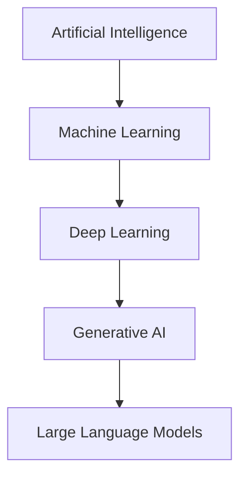
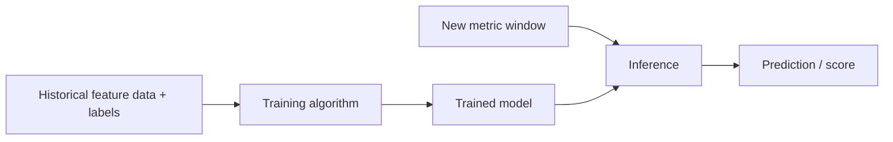

# AI, Machine Learning and Deep Learning

## Learning objectives

After this chapter, you should be able to:

- Distinguish artificial intelligence (AI), machine learning (ML), deep learning and generative AI.
- Explain how rule-based software differs from a learned model.
- Distinguish training from inference.
- Place large language models (LLMs) within the broader AI landscape.
- Identify appropriate AI/ML patterns for SRE problems.

## 1. The broad hierarchy

**Artificial intelligence** is the broad field concerned with building systems that perform tasks associated with intelligent behaviour. **Machine learning** is a family of methods in which systems learn statistical patterns from data. **Deep learning** is a subset of ML based on neural networks with multiple layers. **Generative AI** describes models that generate new content, such as text, images, audio or code. An **LLM** is a language-focused model, usually based on a transformer neural network.



This is a conceptual hierarchy, not a strict taxonomy in which every generative model must be a deep-learning language model. Generative AI includes image, audio and other modalities as well.

## 2. Rule-based programming versus machine learning

In traditional programming, an engineer writes explicit logic. The program applies those rules to inputs.

```python
cpu_percent = 95
error_rate_percent = 22

if cpu_percent > 90 and error_rate_percent > 10:
    print("Potential service incident")
```

This is deterministic rule evaluation. It can be transparent and appropriate when the condition is known and stable. However, engineers must explicitly maintain the rules.

A supervised ML approach instead learns a relationship from examples. For example, a dataset may contain CPU, memory, latency, error rate, restart counts and a label indicating whether an incident occurred in a defined future window.



The model learns statistical associations; it does not inherently know the operational meaning of CPU or pod restarts. Data quality, feature design, labels and evaluation matter.

## 3. SRE examples

| Approach | Example | Strength | Limitation |
| --- | --- | --- | --- |
| Rules | Alert when error rate exceeds a threshold | Explainable, predictable | Thresholds need maintenance; context can be missed |
| Classical ML | Detect unusual latency/traffic patterns | Learns statistical patterns | May produce false positives; needs representative data |
| Deep learning | Model complex relationships in sequential telemetry | Can represent complex patterns | More data and operational complexity may be required |
| Generative AI / LLM | Summarize an incident from supplied alerts, logs and events | Produces useful natural-language synthesis | Can hallucinate; needs grounded context and evaluation |

These approaches can complement one another. An LLM is not a substitute for deterministic alerting, telemetry, service ownership or incident command.

## 4. Training and inference

**Training** is the process of fitting model parameters using data and an optimization procedure. In supervised learning, examples include input features and target labels. Training commonly involves repeated prediction, loss calculation, gradient computation and parameter updates.

**Inference** is using a trained model to produce a prediction or response for new input. In production, inference has operational characteristics such as latency, throughput, resource consumption, availability and output quality.

A useful SRE analogy is the distinction between building and validating a release artifact versus running it in a production service. Training is not simply an offline deployment step in every architecture, but it is conceptually separate from serving predictions.

## 5. Where LLMs fit

An LLM is a language model trained on large text/token datasets. Modern general-purpose LLMs commonly use transformer architectures and generate text by predicting subsequent tokens. They are one category of generative AI, not the whole of AI.

An LLM does not automatically have access to a Kubernetes cluster, Prometheus, logs, traces or runbooks. It can only use information supplied in the prompt/context or obtained through tools explicitly made available to the application.

## 6. Responsible SRE use

Before applying ML or an LLM to operations:

- Define the problem and the decision the output will support.
- Establish a baseline and measurable acceptance criteria.
- Use synthetic or explicitly approved data.
- Keep alerting and safety controls independent of unverified model output.
- Present evidence, uncertainty and unknowns.
- Test against representative cases, including unusual and failure scenarios.
- Require human approval for production changes.

## Knowledge check

1. Explain the difference between rule-based programming and ML.
2. Is an LLM the same thing as generative AI? Explain.
3. Give one SRE problem better suited to deterministic rules and one that may benefit from ML.
4. Explain training versus inference.
5. What information or permissions does an LLM need before it can inspect current Kubernetes state?

## Hands-on exercise

Create a small table of 10–20 **synthetic** service observations with fields such as CPU, memory, error rate and incident label. Write one explicit threshold rule and describe where it might fail. Do not claim to have trained a model; this exercise is about problem framing and the difference between rules and learned patterns.

## Further reading

- [Google: Rules-based programming versus machine learning](https://developers.google.com/machine-learning/intro-to-ml/what-is-ml)
- [Google: Introduction to machine learning](https://developers.google.com/machine-learning/intro-to-ml)
- [Hugging Face LLM Course](https://huggingface.co/learn/llm-course)

## Progress

**Status: In progress.** The concepts have been introduced and discussed. The lesson's formal quiz and practical exercise have not yet been completed and independently assessed.
