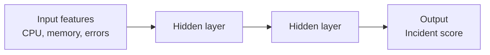
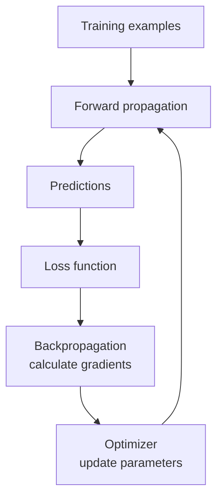

# Neural Networks and Model Training

## Learning objectives

- Describe an artificial neuron and its inputs, weights and bias.
- Explain forward propagation, loss, backpropagation and gradient descent.
- Distinguish backpropagation from the optimizer's parameter update.
- Explain epochs, batches, iterations and overfitting.
- Relate generalization and data drift to production ML reliability.

## 1. An artificial neuron

A simplified artificial neuron takes inputs, multiplies them by learned weights, adds a bias, then applies an activation function.

$
z = \sum_{i=1}^{n} x_i w_i + b
$

$
a = f(z)
$

- (x_i): input feature.
- (w_i): learned weight controlling that feature's contribution.
- (b): learned bias term.
- (f): activation function.
- (a): neuron output.

Weights are not simply manually chosen output knobs in a trained model. Training adjusts them using examples and an optimization procedure.

## 2. Worked SRE example

Consider three normalized, illustrative input signals:

| Feature | Value | Weight | Contribution |
| --- | ---: | ---: | ---: |
| CPU utilization | 0.95 | 0.50 | 0.475 |
| Memory utilization | 0.85 | 0.30 | 0.255 |
| Error rate | 0.20 | 0.80 | 0.160 |
| Bias | — | -0.20 | -0.200 |

The weighted sum is:

$
z=(0.95)(0.50)+(0.85)(0.30)+(0.20)(0.80)-0.20=0.69
$

If the activation function is ReLU, $f(z)=\max(0,z)$, the output is 0.69.

If the CPU weight changes from 0.50 to 0.20, keeping all other values fixed:

$
z=(0.95)(0.20)+0.255+0.160-0.20=0.405
$

The new result is 0.405. This is a manually specified parameter change for illustration; it is not evidence of learning.

## 3. A small Python neuron

This example performs a forward calculation only. The weights are manually supplied; no training occurs.

```python
def relu(value: float) -> float:
    return max(0.0, value)


def neuron(inputs: list[float], weights: list[float], bias: float) -> float:
    if len(inputs) != len(weights):
        raise ValueError("inputs and weights must have equal lengths")

    weighted_sum = sum(x * w for x, w in zip(inputs, weights)) + bias
    return relu(weighted_sum)


features = [0.95, 0.85, 0.20]
weights = [0.50, 0.30, 0.80]
bias = -0.20

print(neuron(features, weights, bias))  # 0.69
```

## 4. Neural network layers

A neural network connects many neurons in layers:

- **Input layer:** receives feature values.
- **Hidden layers:** transform representations using learned parameters and activation functions.
- **Output layer:** produces a score, probability distribution or other prediction.



A network does not inherently know what a metric means. It learns patterns from the examples, labels and objective used during training.

## 5. How training works

A common supervised training loop has these stages:

1. **Forward propagation:** pass inputs through the network to produce a prediction.
2. **Loss calculation:** compare prediction with the target using a loss function.
3. **Backpropagation:** use the chain rule to calculate gradients of the loss with respect to parameters.
4. **Optimizer update:** use those gradients to update parameters, for example with gradient descent.
5. Repeat over batches and training steps.



### Loss

A loss function quantifies the discrepancy between the model's prediction and the target for the training objective. For binary classification, binary cross-entropy is a common choice. Lower training loss generally means the model better fits the training objective, but it does not guarantee good performance on unseen data.

### Backpropagation

Backpropagation calculates gradients—how the loss changes with respect to each parameter—by applying the chain rule through the computation graph.

### Gradient descent

Gradient descent uses gradients to update parameters in a direction intended to reduce loss. For one parameter:

[
w_{	ext{new}} = w_{	ext{old}} - eta rac{partial L}{partial w}
]

Here, $\eta$ is the learning rate and $L$ is the loss. Backpropagation computes the gradient; the optimizer uses it to update parameters. They are related but distinct operations.

A learning rate that is too high can cause unstable updates or overshooting; one that is too low can make optimization slow.

## 6. Training vocabulary

| Term | Meaning |
| --- | --- |
| Epoch | One complete pass through the training dataset |
| Batch | A subset of examples processed together |
| Iteration / step | One optimizer update |
| Weight | A learned model parameter |
| Bias | A learned additive parameter |
| Activation function | Nonlinear or other transformation applied within a neuron |
| Optimizer | Algorithm that updates model parameters |
| Loss | Scalar measure of model error for an objective |

## 7. Generalization and overfitting

A model should perform well on data it has not trained on. **Overfitting** occurs when it fits quirks/noise in training data and performs substantially worse on unseen examples.

Training, validation and test datasets serve different purposes:

- Training data fits model parameters.
- Validation data supports model selection and tuning.
- Test data provides a final estimate of generalization on held-out examples.

A high training accuracy alone does not prove overfitting. Compare it with validation/test results and inspect the evaluation design.

## 8. Production drift

Two related problems can degrade production performance:

- **Data drift:** the distribution of model inputs changes.
- **Concept drift:** the relationship between inputs and the target outcome changes.

Example: a model trained on weekday traffic patterns may behave poorly after a new product launch changes traffic volume and workload composition.

Monitor feature distributions, missing values, prediction distributions and—when reliable labels become available—model quality. Retraining should be evidence-driven and validated, not automatic merely because a metric moved.

## 9. SRE applications and limitations

Potential applications include anomaly detection, capacity forecasting and incident risk scoring. These systems require representative data, robust evaluation, drift monitoring and a safe fallback. A high anomaly score is a signal for investigation, not proof of an incident or root cause.

## Knowledge check

1. What does a weight control in a neuron?
2. What is the difference between backpropagation and gradient descent?
3. Calculate the weighted sum in the worked example.
4. Why does high training accuracy not establish production readiness?
5. Distinguish data drift from concept drift.

## Hands-on assignment

Run the Python neuron example, verify the output 0.69, then change the CPU weight to 0.20 and verify 0.405. Explain why manually changing a weight is not training. A further step (not yet completed) is to implement a tiny trainable model with a framework and evaluate it on held-out synthetic data.

## Further reading

- [3Blue1Brown: Neural networks](https://www.youtube.com/watch?v=aircAruvnKk)
- [3Blue1Brown: Gradient descent](https://www.youtube.com/watch?v=Ilg3gGewQ5U)
- [PyTorch: Learn the Basics](https://pytorch.org/tutorials/beginner/basics/intro.html)

## Progress

**Status: In progress.** Neural networks, weights, forward propagation, loss, backpropagation, gradient descent, overfitting and drift have been discussed. The numeric example was worked through in conversation; the submitted arithmetic was corrected from 0.285 to 0.405. The Python implementation and formal quiz remain pending.
