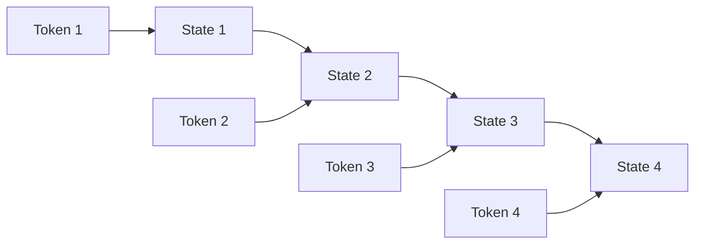
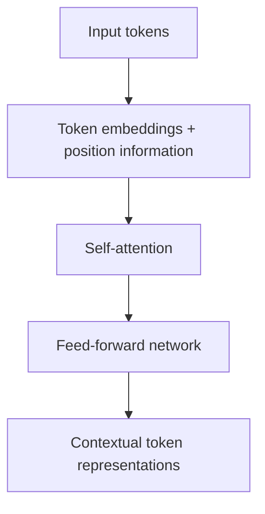
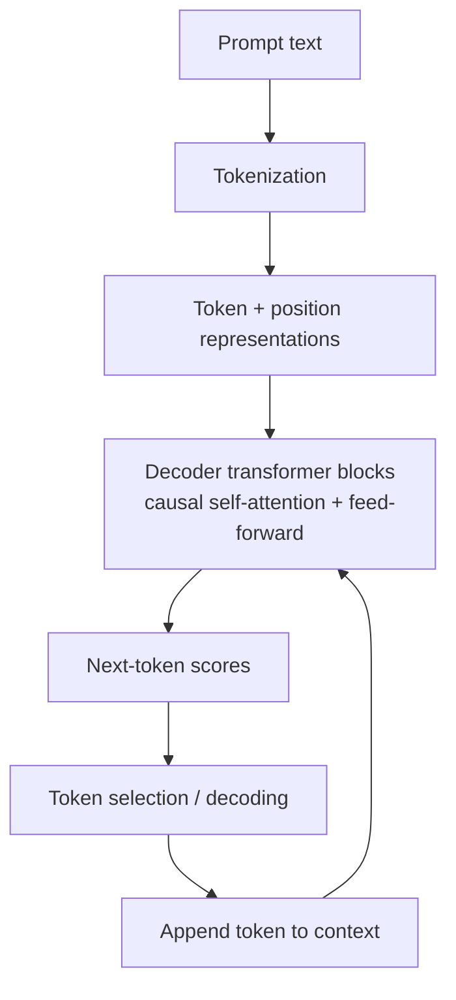

# Transformers and Attention

## Learning objectives

- Explain why sequence models need contextual information.
- Describe recurrent neural networks (RNNs) at a high level and their sequential processing limitation.
- Explain the core idea of transformer self-attention.
- Describe Query, Key and Value (Q, K, V).
- Explain multi-head attention, positional information and causal masking.
- Describe autoregressive next-token generation in decoder-only LLMs.

## 1. Language depends on context

Consider the word **bank**:

- "The bank approved the loan."
- "I sat on the river bank."

The same spelling has different meanings in context. A language model therefore needs representations that incorporate information from surrounding tokens.

Pronouns create another example: "The application restarted because it crashed." A model should learn relationships between "it" and the surrounding words. Attention provides a learned way to mix information across token positions.

## 2. Before transformers: recurrent processing

A recurrent neural network (RNN) processes a sequence step by step. It updates a hidden state as each token arrives, using the previous state and current input.

This sequential dependency makes parallel processing across sequence positions difficult. Long-range information can also be difficult to preserve, although architectures such as LSTMs were designed to improve handling of longer dependencies.

## 3. Transformer idea

The 2017 paper [Attention Is All You Need](https://arxiv.org/abs/1706.03762) introduced the Transformer architecture. Its central idea is to use attention to let token representations incorporate information from other positions, rather than relying on a recurrent hidden state passed one position at a time.

This is a conceptual simplification. Real transformer layers also use residual connections, normalization and architecture-specific components.

## 4. Self-attention intuition

For each token position, self-attention computes how strongly it should incorporate information from other positions in the same sequence. The scores are input-dependent and learned projections are used to form the attention calculation.

For example, in "The application restarted because it crashed", the representation at "it" can attend to "application" and other tokens. Attention weights are not literal human explanations of reasoning; they are coefficients in a learned information-mixing operation.

## 5. Query, Key and Value

Each input representation is projected into three vectors:

- **Query (Q):** what this position is seeking or matching against.
- **Key (K):** the representation used to score how relevant this position is to a query.
- **Value (V):** the information that is combined according to the attention weights.

An SRE retrieval analogy can help: a search query is matched against document descriptors, and relevant document content is returned. This analogy is imperfect: transformer Q, K and V are learned vector projections inside a neural network, not literal runbook metadata fields.

Scaled dot-product attention is:

$$
\operatorname{Attention}(Q,K,V)=\operatorname{softmax}\left(\frac{QK^T}{\sqrt{d_k}}\right)V
$$

Interpretation:

1. $QK^T$ calculates compatibility scores between queries and keys.
2. Dividing by $\sqrt{d_k}$ scales scores by the key dimension.
3. Softmax turns scores into normalized weights.
4. The weights are used to form a weighted combination of value vectors.

The output is a context-aware representation for each query position.

## 6. Multi-head attention

A transformer can perform several attention operations in parallel using different learned projections. These are attention heads. Their outputs are combined, allowing the layer to represent different patterns or relationships.

It is tempting to label heads as "grammar head" or "pronoun head", but heads are not generally assigned such clean human-defined jobs. Their behavior emerges from training and may be distributed or difficult to interpret.

## 7. Position information

Self-attention by itself does not inherently encode sequence order. The model needs positional information so that "the engineer restarted the server" differs from "the server restarted the engineer".

Architectures use different approaches, including learned positional embeddings and rotary positional embeddings (RoPE). Do not assume every transformer uses the same positional method.

## 8. GPT-style decoder-only transformers

GPT-style language models use a decoder-only transformer. They are trained for next-token prediction and generate autoregressively: predict one token, append it to the context, then predict the next.

**Causal (masked) self-attention** prevents a position from attending to future positions during next-token training/generation. This preserves the direction of the prediction task: the model predicts the next token using the available preceding context.

A model produces a score distribution over possible next tokens. A decoding strategy (for example, greedy selection or sampling) chooses the next token. This repeats until a stopping condition is reached.

The model is not necessarily choosing the single most probable token every time; the decoding configuration matters.

## 9. Transformer building blocks

A typical transformer block includes:

- **Self-attention:** mixes information across token positions.
- **Feed-forward network:** transforms each position's representation.
- **Residual connections:** provide skip paths that support information and gradient flow.
- **Layer normalization:** normalizes activations to support stable training.

Exact ordering and variants differ between architectures.

## 10. SRE application

An LLM can synthesize supplied incident information:

- Deployment event: payment-api v2.4.1 completed.
- Alert: HTTP 500 rate increased.
- Log evidence: database connection timeout.
- Kubernetes event: three pods restarted.

It may draft a hypothesis that the deployment and database connection behavior are related. This is not proof of root cause. To investigate live state, the surrounding application must supply authorized telemetry/tool results. To ground recommendations in runbooks, it can use retrieval. The system should preserve evidence links and uncertainty.

The transformer is a language-processing component, not a complete incident management platform.

## Limitations and trade-offs

- Attention computes learned relationships; it is not guaranteed factual reasoning.
- Context length is finite and long contexts can increase cost/latency.
- Attention weights should not be treated as complete explanations.
- Causal masking applies to autoregressive decoder behavior; encoder and other architectures can use different attention masks.
- A model cannot inspect external infrastructure without data or tools being provided.

## Knowledge check

1. Why is sequential processing a limitation for RNN training?
2. What role does self-attention play?
3. Explain Q, K and V using the SRE retrieval analogy, and state where that analogy breaks down.
4. Why do transformers need positional information?
5. What does causal masking prevent during next-token prediction?

## Hands-on assignment

Draw a decoder-only transformer flow from prompt to token generation. Annotate where tokenization, positional information, causal self-attention, next-token scoring and decoding occur. Then explain which parts would need to be connected to telemetry and runbooks to create an AI incident assistant.

## Further reading

- [Attention Is All You Need (2017)](https://arxiv.org/abs/1706.03762)
- [The Illustrated Transformer](https://jalammar.github.io/illustrated-transformer/)
- [3Blue1Brown: Attention in transformers](https://www.youtube.com/watch?v=wjZofJX0v4M)
- [The Annotated Transformer](https://nlp.seas.harvard.edu/annotated-transformer/)

## Progress

**Status: In progress.** Transformers, self-attention, Q/K/V, multi-head attention, positional information, causal masking and autoregressive generation have been introduced in the lesson. The formal quiz and assignment have not yet been completed.
