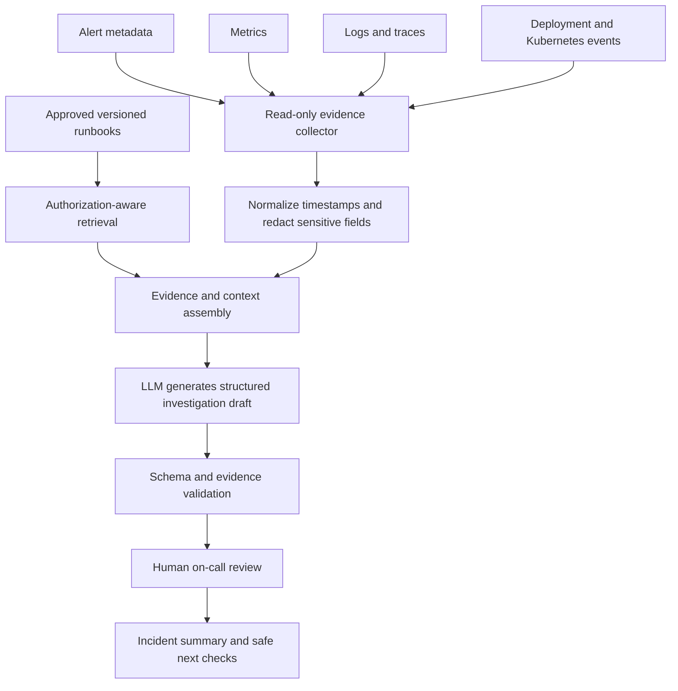

# Design lab: AI incident assistant

**Status:** Reference solution documented and committed.

## Scenario

A synthetic Kubernetes service called `payment-api` is showing the following symptoms:

- HTTP 500 error rate is above 20%.
- Three pods restarted.
- Database connection timeouts increased.
- A deployment completed about 10 minutes before the symptoms began.

The task is to design an assistant that helps an on-call engineer investigate without taking autonomous production actions.

## Suggested architecture

The LLM is not the telemetry collector. The surrounding application obtains authorized data and supplies bounded context. Retrieval must enforce the caller's access rights.

## 1. Inputs

- Alert name, severity, labels, timestamps and affected service/namespace/cluster.
- Time-bounded logs with timestamps and trace/request identifiers where available.
- Metrics including request rate, error rate, latency, CPU, memory, restarts and database timeout/connection metrics.
- Distributed traces and dependency spans where available.
- Deployment/configuration events, Kubernetes events and pod/container state.
- Approved runbooks, service ownership and dependency metadata.

Normalize timestamps. Restrict the query window to the incident and relevant baseline. Redact secrets and sensitive values before model processing.

## 2. Structured output

Require a schema such as:

- Incident impact and scope.
- Timeline of significant events.
- Observed facts with source references.
- Candidate hypotheses and supporting/contradicting evidence.
- Unknowns and missing evidence.
- Safe read-only investigation steps.
- Concise handoff summary.

Do not allow the model to turn a hypothesis into a confirmed root cause without evidence.

## 3. Investigation approach

1. Establish when the error-rate increase began.
2. Compare the deployment and configuration-change time with the symptom timeline.
3. Compare pre-deployment and post-deployment metrics.
4. Inspect database timeout logs and traces for affected requests.
5. Correlate pod restarts with termination reasons, readiness failures and resource pressure.
6. Form multiple hypotheses and state what evidence would confirm or refute each.
7. Present the evidence and uncertainty to the on-call engineer.

A deployment happening before an incident is a temporal correlation, not proof of causation.

## 4. Safety boundaries

The initial assistant should be read-only. It must not autonomously:

- Restart or delete pods.
- Roll back deployments.
- Scale workloads.
- Change configuration or database settings.
- Silence or suppress alerts.
- Execute state-changing commands.

Use least-privilege credentials, audit every tool invocation, apply timeouts/rate limits, and require explicit human approval for any future state-changing workflow.

## 5. Hallucination and quality controls

- Ground claims in supplied telemetry and approved, versioned runbooks.
- Require evidence links or source identifiers for operational claims.
- Separate observed facts, inferences and recommendations.
- Return an explicit unknown/insufficient-evidence result when inputs are missing.
- Validate structured output against a schema.
- Evaluate with synthetic cases containing misleading, incomplete and conflicting evidence.
- Measure evidence/citation correctness, unsafe recommendation rate, completeness and abstention quality.

## Acceptance criteria

- The system identifies the time range and affected service.
- Every operational claim links to an evidence item or is explicitly labelled as an inference.
- It presents at least one plausible alternative hypothesis when evidence is ambiguous.
- It identifies missing evidence rather than inventing it.
- It proposes only read-only next checks.
- It performs no production mutation.

## Completion evidence

This is a committed reference design in Markdown with an architecture diagram, input/output contract, investigation workflow, safety constraints and acceptance criteria. It satisfies the documentation-artifact completion criterion. Independent learner implementation or mastery remains a separate assessment.
