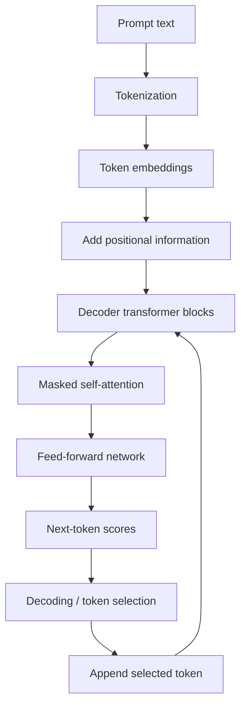

# Design lab: Trace a decoder-only transformer

**Status:** Reference solution documented and committed.

This lab is a documentation-first exercise because the objective is to explain and trace an architecture, not implement a transformer from scratch.

## Reference architecture

## Walk-through

1. **Tokenization:** convert input text into token IDs according to the model's tokenizer.
2. **Token embeddings:** map token IDs to learned vector representations.
3. **Positional information:** provide information about sequence position/order using the architecture's positional method.
4. **Decoder blocks:** repeatedly transform token representations using masked self-attention and feed-forward sublayers (with residual and normalization components).
5. **Next-token scores:** project the final representation to scores over the vocabulary.
6. **Decoding:** select or sample a next token according to the decoding configuration.
7. **Autoregressive loop:** append the selected token to the context and repeat until a stopping condition is met.

## Connection to an AI incident assistant

The transformer is not the data integration layer. The application must separately obtain authorized alerts, metrics, logs, traces, deployment events and runbook passages, then supply relevant context to the model. The model can draft a hypothesis and summary; the system must preserve evidence references and uncertainty.

## Key safeguards

- Causal masking prevents attention to future tokens during autoregressive prediction.
- Attention weights are not complete explanations of the model's reasoning.
- The model cannot inspect live Kubernetes state without supplied data or authorized tools.
- Generated root-cause hypotheses must be checked against telemetry and human investigation.

## Completion evidence

This architecture reference is committed as a Markdown document with a Mermaid flow diagram and explanatory walkthrough. The artifact criterion is met. Independent learner explanation or oral assessment remains a separate mastery check.
