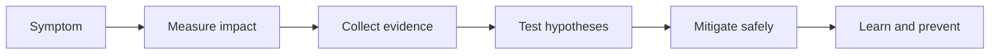

# SRE Handbook

> A practical, evidence-first handbook for building reliable systems and explaining the trade-offs behind them.

This is a personal learning and interview-preparation site for senior SRE and platform-engineering work. Every example is deliberately generic and safe to adapt; it is not a substitute for a team's approved runbooks.

## Choose a track

| Track | Start with | Outcome |
|---|---|---|
| Reliability foundations | [SLIs and SLOs](fundamentals/sli-slo-sla.md) | Set measurable reliability goals and alerts. |
| Production debugging | [Linux](linux/index.md) → [Networking](networking/index.md) | Gather evidence without guessing. |
| Cloud-native operations | [Kubernetes](kubernetes/index.md) → [EKS](eks/index.md) | Operate workloads, identity, networking, and upgrades. |
| Delivery and platforms | [CI/CD](cicd/index.md) → [GitOps](gitops/index.md) | Ship safely with controlled blast radius. |
| Interview practice | [Scenarios](interview-prep/scenario-based.md) | Communicate triage and trade-offs clearly. |

## Featured guides

- [Error budgets and burn-rate alerts](fundamentals/error-budgets.md) — turn a reliability target into decision signals.
- [Kubernetes operations](kubernetes/index.md) — scheduling, rollout safety, and systematic failure analysis.
- [Observability](observability/index.md) — connect metrics, logs, and traces during an incident.
- [Hands-on labs](hands-on-labs/index.md) — local-first exercises with validation and cleanup.

## How to use this handbook

Read a concept, reproduce the small exercise in a disposable environment, then practice describing the decision in the interview questions. In production, begin with impact and a hypothesis, collect evidence, choose the smallest reversible mitigation, and record learning afterward.

