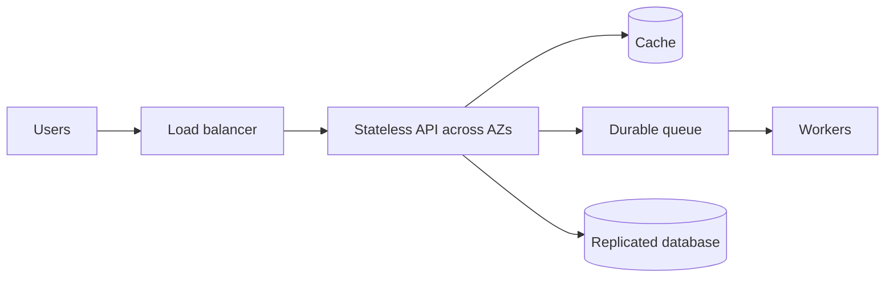

# System design for reliability

Start an interview design by clarifying users, traffic, consistency, latency, availability, data sensitivity, RTO/RPO, and budget. State assumptions numerically, then make failure domains explicit.

## Resilience patterns

Use timeouts, bounded retries with jitter, idempotency, rate limits, circuit breakers, bulkheads, and queues where semantics allow. Each pattern has a cost: caching risks staleness; queues increase async complexity; replication creates lag/failover decisions; multi-region adds data and operational complexity.

## Exercise

Design a notification API at 1,000 requests/s. Identify one dependency outage, one AZ loss, one queue backlog, one bad deployment, and one data-corruption path. For each, state detection, mitigation, data behavior, and recovery objective.
